# Secure Task API

SENG3080 Lab 6. Express Task API with Sequelize (SQLite), express-validator, Helmet, Passport authentication and Redis caching.

## Installation

Requires Node.js and Docker Desktop.

```bash
git clone https://github.com/jfmonterocortes/secure-task-api.git
cd secure-task-api
npm install
cp .env.example .env
```

Set a long random `SESSION_SECRET` in `.env`.

## Start Redis

```bash
docker run -d --name week7-redis -p 6379:6379 redis:7-alpine
docker ps
```

To start it again later: `docker start week7-redis`

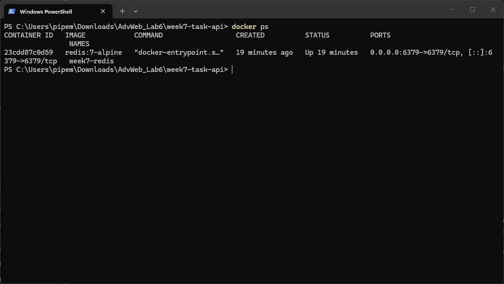

## Run the server

```bash
npm run dev
```

The API runs at `http://localhost:3000`.

## Test record

| Test | Expected result | Result |
|---|---|---|
| GET /api/tasks/health | 200 JSON status response; request logger output | **PASS** - 200 `{"status":"ok"}`, logger printed `GET /api/tasks/health` ([screenshot](Screenshots/p1-health.png), [log](Screenshots/p1-logger.txt)) |
| POST invalid task | 400 with validation errors | **PASS** - 400 `title must be 3-120 characters` ([screenshot](Screenshots/p4-invalid.png)) |
| POST valid task | 201 and a task with id | **PASS** - 201 `{"id":2, ...}` ([screenshot](Screenshots/p4-valid.png)) |
| GET missing task | 404 Task not found | **PASS** - 404 `{"error":"Task not found"}` ([screenshot](Screenshots/p3-404.png)) |
| Security header check | At least one Helmet header is present | **PASS** - `X-Content-Type-Options: nosniff` ([screenshot](Screenshots/p5-headers.png)) |
| GET /api/auth/me before login | 401 Sign in required | **PASS** - 401 `{"error":"Sign in required"}` ([screenshot](Screenshots/p6-me-401.png)) |
| Register, login, then GET /me | 201, 200, then 200 with current user | **PASS** - 201, 200, 200 ([register](Screenshots/p6-register.png), [login](Screenshots/p6-login.png), [me](Screenshots/p6-me.png)) |
| Two GET /api/tasks calls | database then cache source | **PASS** - `database`, then `cache` ([1](Screenshots/p7-database.png), [2](Screenshots/p7-cache.png)) |
| Create task then GET /api/tasks | database source and fresh data after invalidation | **PASS** - `database` with the new task ([create](Screenshots/p7-create.png), [get](Screenshots/p7-invalidated.png)) |

## npm audit

2 moderate vulnerabilities in `uuid` (a dependency of Sequelize). `npm audit fix --force` would downgrade Sequelize to 3.30.0, a breaking change, so it was not applied. ([screenshot](Screenshots/p5-audit.png))

## Why each technology

* ORM (Sequelize) - prevents SQL injection via parameterized queries, objects over SQL
* express-validator - ensures bad data is rejected before hitting the database with a 400
* Helmet - protects against MIME sniffing, clickjacking and XSS via security headers
* Passport - used for authentication/login
   * bcrypt is used for password hashing
   * sessions provide user authentication
* compression - faster responses due to smaller response size
* Redis - used as a cache, GET operations on cached data bypass the database
   * data is invalidated on update

## Screenshots

### GET /api/tasks/health (200)
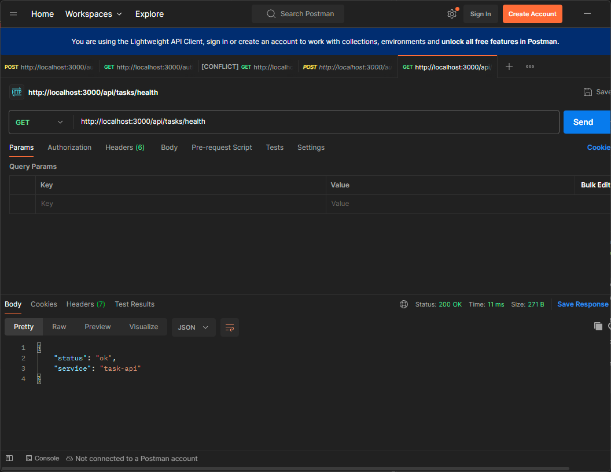

### POST invalid task (400)
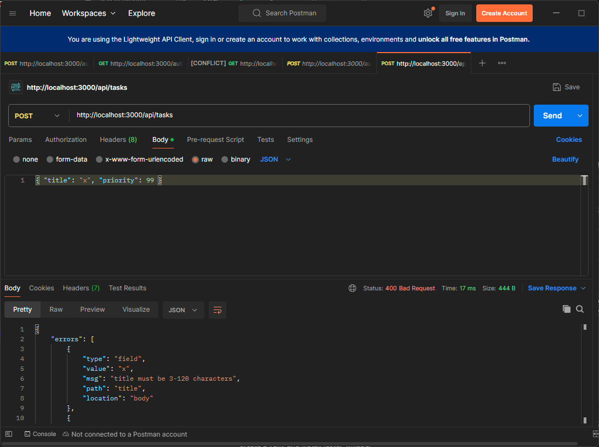

### POST valid task (201)
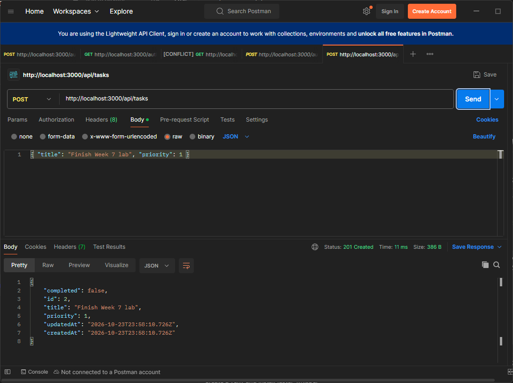

### GET missing task (404)
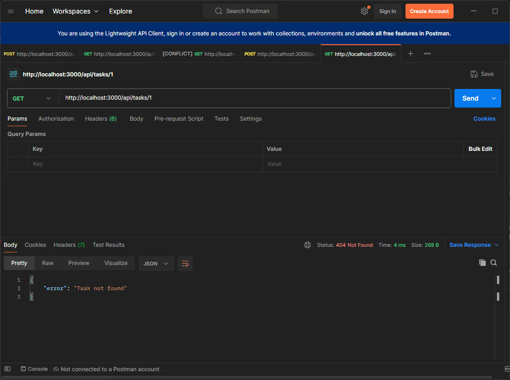

### Security headers
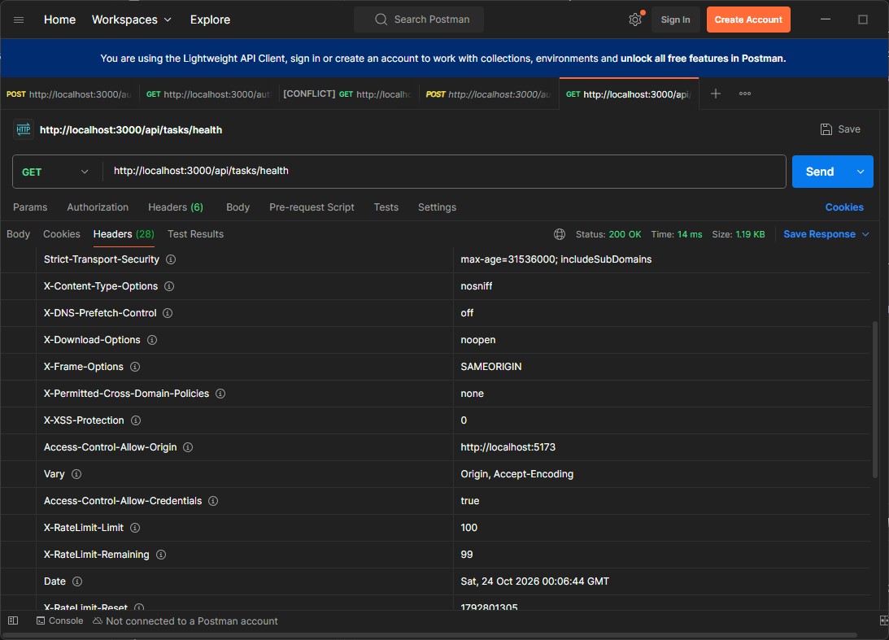

### GET /api/auth/me before login (401)
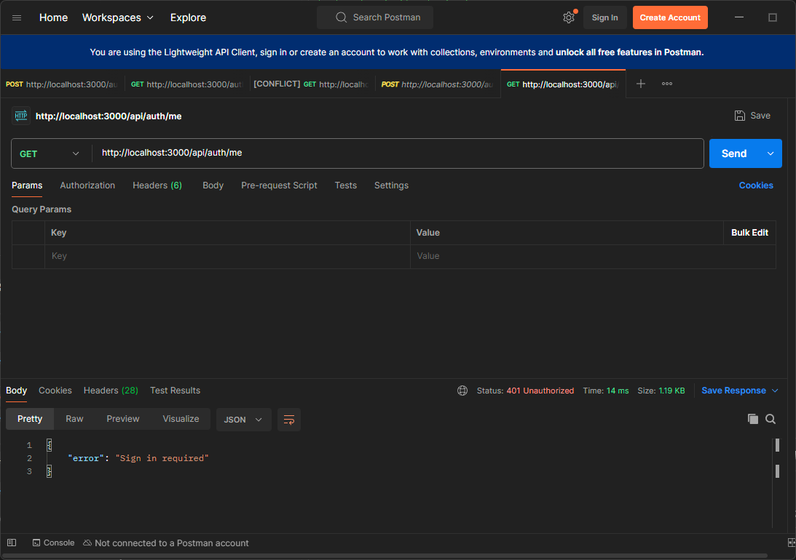

### Register (201)
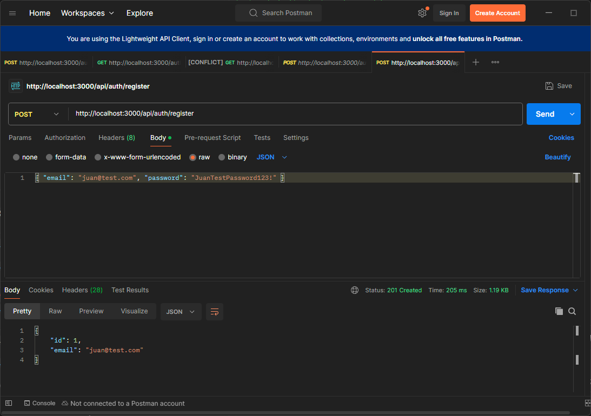

### Login (200)


### GET /api/auth/me after login (200)


### GET /api/tasks first call (database)


### GET /api/tasks second call (cache)
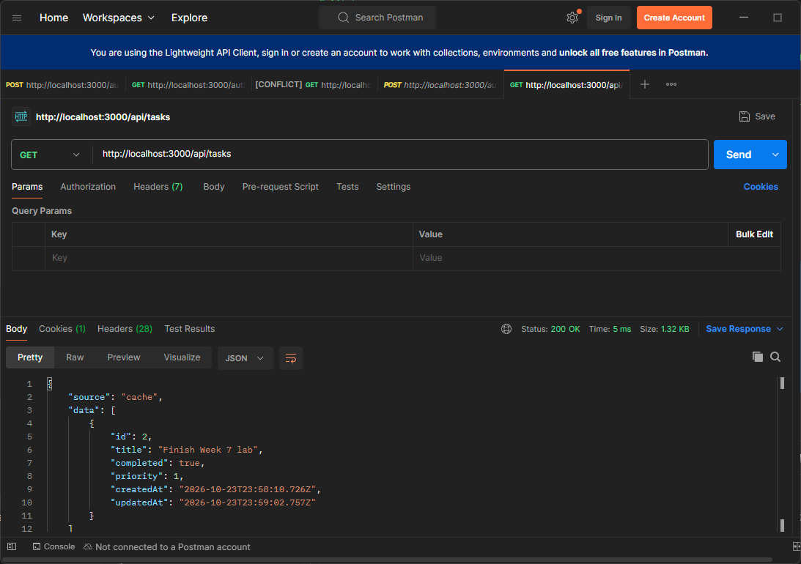

### POST task (201)
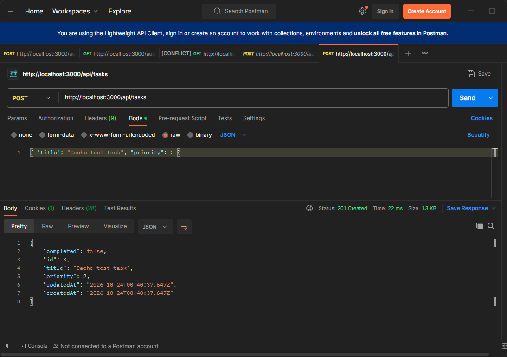

### GET /api/tasks after invalidation (database)
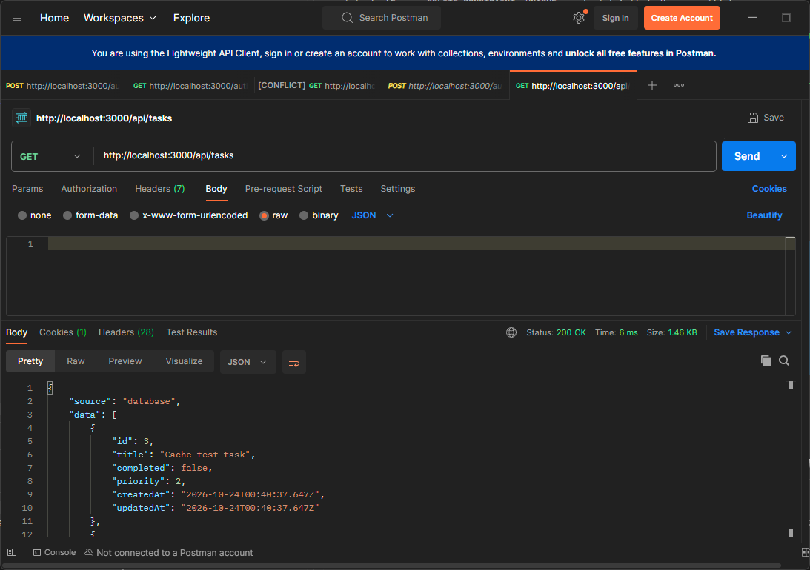

### npm audit
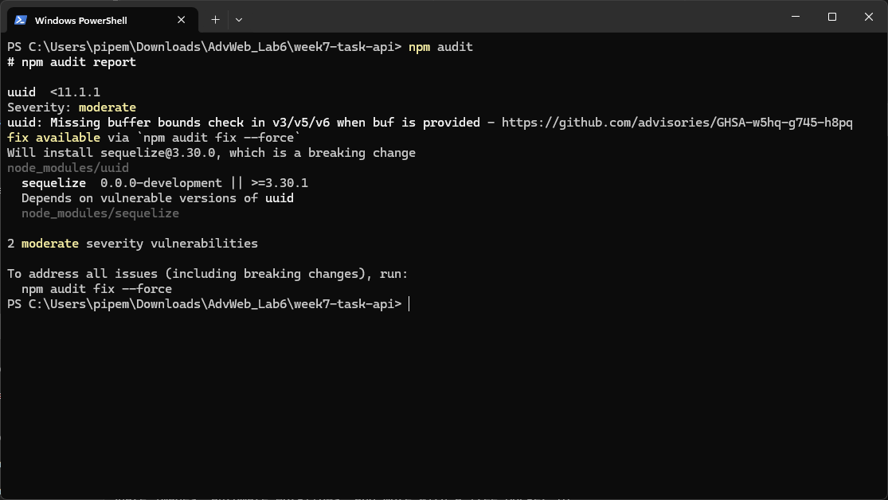
